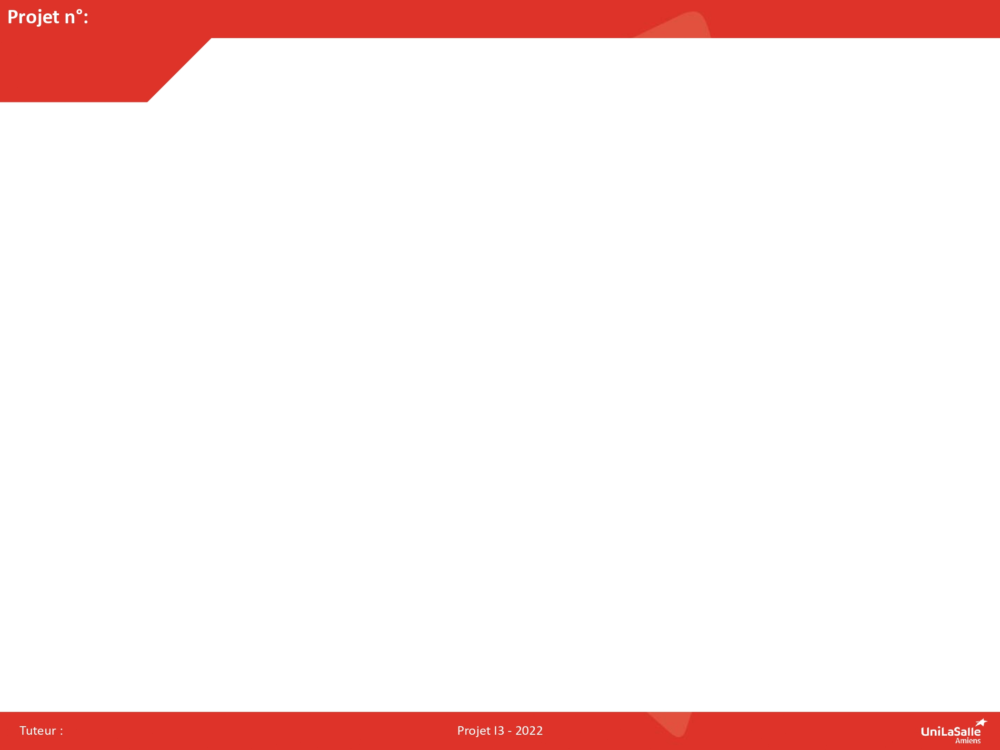

# Edge-computing-par-TinyML-sur-ESP32

{: .a_modifier }
> Remplacez le titre ci-dessus et le texte ci-dessous par une présentation de votre projet.

Ce projet a pour but de mettre en place une chaîne complète d’edge computing par TinyML : un modèle d’IA léger est entraîné sur PC avec TensorFlow, compressé (quantification int8, format TensorFlow Lite), puis déployé sur un microcontrôleur ESP32 équipé d’une caméra. La carte analyse les images en temps réel, directement là où elles sont produites, sans connexion réseau ni serveur distant. La reconnaissance d’un chien et d’un chat sert de cas d’usage démonstrateur.

Il s’adresse d’abord aux étudiants, grâce à un guide pédagogique pas à pas qui leur permettra de reproduire la démarche et de l’adapter à d’autres cas d’usage. À terme, il vise les acteurs de la santé (télé-expertise, recherche, enseignement, médecine de terrain).

L’analyse d’images par IA passe souvent par le cloud, avec de la latence, une dépendance au réseau et des risques pour la confidentialité. Le projet réalise cette analyse en local sur un ESP32 avec caméra, en relevant le défi des contraintes d’un système embarqué (mémoire limitée, rapidité d’inférence, précision après compression). Il fournit une chaîne reproductible pour les étudiants et prépare l’anonymisation locale de données de santé.

[Notre repo GitHub]({{ site.gh_edit_repository }}){: .btn .btn-primary .fs-5 .mb-4 .mb-md-0 .mr-2 }
[Notre projet sur Onshape](https://cad.onshape.com/){: .btn .fs-5 .mb-4 .mb-md-0 }

{: .a_modifier }
> Remplacez le lien du bouton « Onshape » par le lien de partage de votre document.
> Le bouton « repo GitHub » utilise l'adresse renseignée dans `docs/_config.yml`.

## Le projet en 3D



{: .a_modifier }
> Exportez votre assemblage au format **GLB** (glTF binaire) depuis Onshape
> (clic droit sur l'onglet de l'assemblage > Exporter), placez-le dans `docs/assets/models/`,
> remplacez `Otto.glb` ci-dessus par le nom de votre fichier, puis supprimez `Otto.glb`.
> Gardez le fichier sous **25 Mo**.

## Poster

{: .a_modifier }
> Remplacez `docs/assets/images/poster.jpg` par votre poster (image de moins de **2 Mo**).

## Vidéo

<video src="assets/images/intro_amiens.mp4" controls title="Présentation du projet" style="width: 100%;"></video>

{: .a_modifier }
> Remplacez `docs/assets/images/intro_amiens.mp4` par votre vidéo :
> - 1 min 30 au format vertical ;
> - présentation du projet, fonctionnement, vues du prototype, conclusion ;
> - moins de **25 Mo** (exportez en 720p, par exemple avec HandBrake).
>
> Voir [Créer le poster et la vidéo de présentation](https://doc.makerspace-amiens.fr/workshops/methodologie-de-projet/tutorials/poster-video-presentation/).
